<!--
  Every image below is rendered by scripts/build.py — edit words and colours there, not the SVGs.
  .github/workflows/profile.yml re-renders them twice a day so the numbers stay current.
  Images inside one row must stay on one line: any whitespace between them becomes a gap and breaks the grid.
-->

<a href="https://swapnilgupta.in"><picture><source media="(prefers-color-scheme: dark)" srcset="assets/dark/hero.svg"><source media="(prefers-color-scheme: light)" srcset="assets/light/hero.svg"></picture></a>

<a href="#about"><picture><source media="(prefers-color-scheme: dark)" srcset="assets/dark/nav-about.svg"><source media="(prefers-color-scheme: light)" srcset="assets/light/nav-about.svg"></picture></a><a href="#stack"><picture><source media="(prefers-color-scheme: dark)" srcset="assets/dark/nav-stack.svg"><source media="(prefers-color-scheme: light)" srcset="assets/light/nav-stack.svg"></picture></a><a href="#work"><picture><source media="(prefers-color-scheme: dark)" srcset="assets/dark/nav-work.svg"><source media="(prefers-color-scheme: light)" srcset="assets/light/nav-work.svg"></picture></a><a href="#numbers"><picture><source media="(prefers-color-scheme: dark)" srcset="assets/dark/nav-numbers.svg"><source media="(prefers-color-scheme: light)" srcset="assets/light/nav-numbers.svg"></picture></a><a href="#contact"><picture><source media="(prefers-color-scheme: dark)" srcset="assets/dark/nav-contact.svg"><source media="(prefers-color-scheme: light)" srcset="assets/light/nav-contact.svg"></picture></a>

 

<picture><source media="(prefers-color-scheme: dark)" srcset="assets/dark/about.svg"><source media="(prefers-color-scheme: light)" srcset="assets/light/about.svg"></picture>

 

<picture><source media="(prefers-color-scheme: dark)" srcset="assets/dark/stack.svg"><source media="(prefers-color-scheme: light)" srcset="assets/light/stack.svg"></picture>

 

<picture><source media="(prefers-color-scheme: dark)" srcset="assets/dark/work.svg"><source media="(prefers-color-scheme: light)" srcset="assets/light/work.svg"></picture>

<a href="https://chalkpad-web.vercel.app/"><picture><source media="(prefers-color-scheme: dark)" srcset="assets/dark/work-chalkpad.svg"><source media="(prefers-color-scheme: light)" srcset="assets/light/work-chalkpad.svg"></picture></a><a href="https://cmpx.vercel.app/"><picture><source media="(prefers-color-scheme: dark)" srcset="assets/dark/work-compilex.svg"><source media="(prefers-color-scheme: light)" srcset="assets/light/work-compilex.svg"></picture></a>

<a href="https://org-synapse.vercel.app"><picture><source media="(prefers-color-scheme: dark)" srcset="assets/dark/work-synapse.svg"><source media="(prefers-color-scheme: light)" srcset="assets/light/work-synapse.svg"></picture></a><a href="https://blueberry-ui-site.vercel.app"><picture><source media="(prefers-color-scheme: dark)" srcset="assets/dark/work-blueberry.svg"><source media="(prefers-color-scheme: light)" srcset="assets/light/work-blueberry.svg"></picture></a>

<b>More things I've built</b>&nbsp;&nbsp;·&nbsp;&nbsp;9 projects

 

- **[Cricify](https://cricify.vercel.app)** — cricket tournament organiser for teams, fixtures and results
- **[GrabNGoods](https://grab-n-goods-e-commerce-web-application.vercel.app)** — e-commerce storefront on React and Redux Toolkit
- **[Trip Planner](https://trip-planner-app-ten.vercel.app/)** — a TypeScript trip-planning app
- **[French Fries](https://french-fries.vercel.app/)** — agency site with GSAP and Framer Motion
- **[Rejouice](https://swapnilgupta14.github.io/rejouice/)** — animated landing page with GSAP and Swiper
- **[IP Address Tracker](https://swapnilgupta14.github.io/IP-Address-Tracker/)** — IP lookup with live map rendering via Leaflet
- **[Stock Trend Predictor](https://github.com/swapnilgupta14/Stock-Growth-Prediction-Project-using-LSTM)** — LSTM-based price forecasting, served with Streamlit
- **[ResNet50 for Autonomous Driving](https://github.com/swapnilgupta14/CNN-Based-Neural-Network-for-the-Autonomous-Vehicle-based-on-ResNet50-Architecture)** — CNN steering model inspired by NVIDIA's end-to-end approach
- **[Sorting Visualizer](https://github.com/swapnilgupta14/Sorting-Graphic-Visualizer)** — watch sorting algorithms work step by step

 

<a href="https://github.com/swapnilgupta14?tab=repositories"><picture><source media="(prefers-color-scheme: dark)" srcset="assets/dark/numbers.svg"><source media="(prefers-color-scheme: light)" srcset="assets/light/numbers.svg"></picture></a>

 

<picture><source media="(prefers-color-scheme: dark)" srcset="assets/dark/contact.svg"><source media="(prefers-color-scheme: light)" srcset="assets/light/contact.svg"></picture>

<a href="https://swapnilgupta.in"><picture><source media="(prefers-color-scheme: dark)" srcset="assets/dark/btn-website.svg"><source media="(prefers-color-scheme: light)" srcset="assets/light/btn-website.svg"></picture></a><a href="https://www.linkedin.com/in/swapnilgupta-ln/"><picture><source media="(prefers-color-scheme: dark)" srcset="assets/dark/btn-linkedin.svg"><source media="(prefers-color-scheme: light)" srcset="assets/light/btn-linkedin.svg"></picture></a><a href="mailto:mail.swapnilgupta@gmail.com"><picture><source media="(prefers-color-scheme: dark)" srcset="assets/dark/btn-email.svg"><source media="(prefers-color-scheme: light)" srcset="assets/light/btn-email.svg"></picture></a><a href="#top"><picture><source media="(prefers-color-scheme: dark)" srcset="assets/dark/top.svg"><source media="(prefers-color-scheme: light)" srcset="assets/light/top.svg"></picture></a>

