<!--
  Every image below is rendered by scripts/build.py — edit words and colours there, not the SVGs.
  .github/workflows/profile.yml re-renders them twice a day so the numbers stay current.
  Images inside one row must stay on one line: any whitespace between them becomes a gap and breaks the grid.
-->

<a href="https://swapnilgupta.in" title="Visit swapnilgupta.in"><picture><source media="(prefers-color-scheme: dark)" srcset="assets/dark/hero.svg"><source media="(prefers-color-scheme: light)" srcset="assets/light/hero.svg"></picture></a>

<a href="https://swapnilgupta.in/?ask=1#ask" title="Chat with sAI, the assistant on swapnilgupta.in"><picture><source media="(prefers-color-scheme: dark)" srcset="assets/dark/composer.svg"><source media="(prefers-color-scheme: light)" srcset="assets/light/composer.svg"></picture></a>

<picture><source media="(prefers-color-scheme: dark)" srcset="assets/dark/band.svg"><source media="(prefers-color-scheme: light)" srcset="assets/light/band.svg"></picture>

  

<picture><source media="(prefers-color-scheme: dark)" srcset="assets/dark/about.svg"><source media="(prefers-color-scheme: light)" srcset="assets/light/about.svg"></picture>

  

<picture><source media="(prefers-color-scheme: dark)" srcset="assets/dark/stack.svg"><source media="(prefers-color-scheme: light)" srcset="assets/light/stack.svg"></picture>

  

<picture><source media="(prefers-color-scheme: dark)" srcset="assets/dark/work.svg"><source media="(prefers-color-scheme: light)" srcset="assets/light/work.svg"></picture>

<a href="https://chalkpad-web.vercel.app/" title="Open ChalkPad — chalkpad-web.vercel.app"><picture><source media="(prefers-color-scheme: dark)" srcset="assets/dark/work-chalkpad.svg"><source media="(prefers-color-scheme: light)" srcset="assets/light/work-chalkpad.svg"></picture></a><a href="https://cmpx.vercel.app/" title="Open CompileX — cmpx.vercel.app"><picture><source media="(prefers-color-scheme: dark)" srcset="assets/dark/work-compilex.svg"><source media="(prefers-color-scheme: light)" srcset="assets/light/work-compilex.svg"></picture></a>

<a href="https://org-synapse.vercel.app" title="Open Synapse — org-synapse.vercel.app"><picture><source media="(prefers-color-scheme: dark)" srcset="assets/dark/work-synapse.svg"><source media="(prefers-color-scheme: light)" srcset="assets/light/work-synapse.svg"></picture></a><a href="https://github.com/swapnilgupta14/Stock-Growth-Prediction-Project-using-LSTM" title="View Stock Trend Predictor on GitHub"><picture><source media="(prefers-color-scheme: dark)" srcset="assets/dark/work-stocks.svg"><source media="(prefers-color-scheme: light)" srcset="assets/light/work-stocks.svg"></picture></a>

  

<a href="https://github.com/swapnilgupta14?tab=repositories" title="Browse all repositories"><picture><source media="(prefers-color-scheme: dark)" srcset="assets/dark/numbers.svg"><source media="(prefers-color-scheme: light)" srcset="assets/light/numbers.svg"></picture></a>

  

<picture><source media="(prefers-color-scheme: dark)" srcset="assets/dark/contact.svg"><source media="(prefers-color-scheme: light)" srcset="assets/light/contact.svg"></picture>

<a href="https://swapnilgupta.in" title="swapnilgupta.in"><picture><source media="(prefers-color-scheme: dark)" srcset="assets/dark/btn-website.svg"><source media="(prefers-color-scheme: light)" srcset="assets/light/btn-website.svg"></picture></a><a href="https://www.linkedin.com/in/swapnilgupta-ln/" title="Connect on LinkedIn"><picture><source media="(prefers-color-scheme: dark)" srcset="assets/dark/btn-linkedin.svg"><source media="(prefers-color-scheme: light)" srcset="assets/light/btn-linkedin.svg"></picture></a><a href="mailto:mail.swapnilgupta@gmail.com" title="mail.swapnilgupta@gmail.com"><picture><source media="(prefers-color-scheme: dark)" srcset="assets/dark/btn-email.svg"><source media="(prefers-color-scheme: light)" srcset="assets/light/btn-email.svg"></picture></a><a href="#top" title="Back to top"><picture><source media="(prefers-color-scheme: dark)" srcset="assets/dark/top.svg"><source media="(prefers-color-scheme: light)" srcset="assets/light/top.svg"></picture></a>

